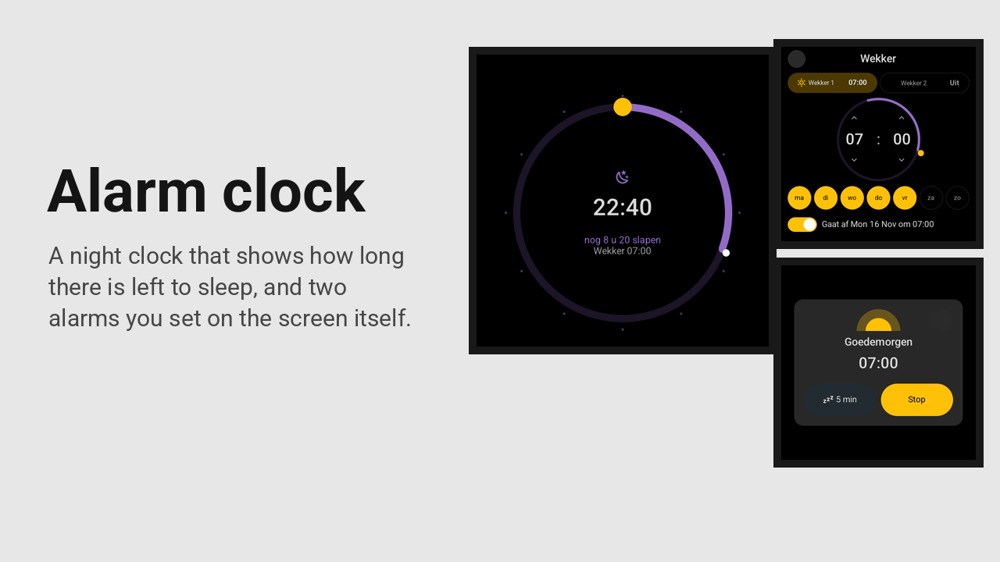
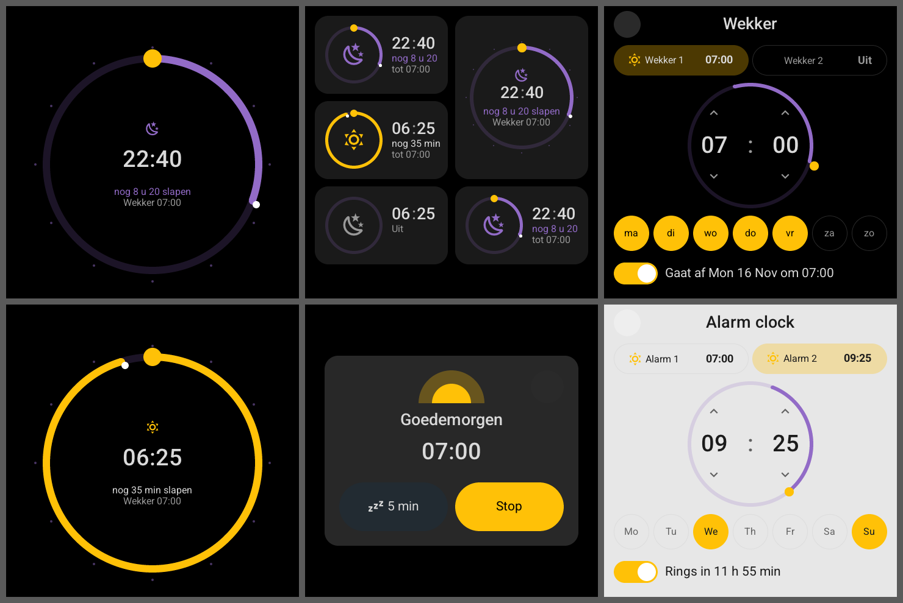

# Alarm clock

> New, and not yet tried on a real screen. Needs Tessera's dev branch (plugin API 0.25) until its next release.

A night clock and two alarms for a Tessera screen, set on the screen itself: no phone and no Home Assistant needed to
change a wake-up time. The tile is a clock in a ring that fills in the twelve hours before the alarm, towards a sun at
its top, and says how long there is left to sleep. In the last hour it turns from the night's purple to the morning's
amber. When an alarm goes off a sun rises in a popup with **Snooze** and **Stop**, and a screen with a speaker rings.

Every alarm is also an entity of the screen in Home Assistant: an automation can set an alarm, and act when one rings,
with any speaker and any sound you like.



## Set up

1. In Tessera, open Plugins, choose **Add with a link** and paste
   `https://github.com/woldhek/tessera-plugin-alarm-clock`.
2. Tick the screen and apply. The screen builds once.
3. In Layout, place the **Night clock** tile from the library's Plugins group, at any size from 1x1 to 2x2, or as a
   whole page.
4. On the screen, tap the tile. Choose **Alarm 1** or **Alarm 2**, set the time with the arrows, tap the days, and turn
   the switch on.

## On the screen

- **The night clock (tile).** The time now in a ring. The ring stands for the twelve hours before the next alarm: it
  fills in towards the sun at its top, a white dot where it is now, with "8 h 20 min left to sleep" and the alarm's
  time under the clock. In the last hour the ring and its icon turn amber. An alarm more than twelve hours away: the
  ring is empty and the words say when it rings. From 1x1 (the ring beside the words, shorter words where they must)
  to 2x2, or a whole page beside a bed. A tap opens the card.
- **The card.** At the top the two alarms as pills, each with its time; the chosen one is lit. Under it the chosen
  alarm's time inside a ring of the day: midnight at the top, the sun on the alarm's time, the eight hours before it in
  purple. Arrows above and below the hours and the minutes set the time (the minutes go in fives). Then its days as
  round keys, Monday first, amber when chosen, and a switch that says when it rings: "Rings in 9 h 30 min", or a day
  and a time. Every tap is kept at once: there is nothing to save.
- **No days chosen**: the alarm rings once, at its next time, and turns itself off.
- **When an alarm goes off** the screen lights up, also from standby and at night: a sun rises over the popup's edge
  and breathes, with "Good morning" (or afternoon, evening) and the time. **Stop** ends it. The snooze key (a moon and
  its minutes) makes it ring again later; the popup's close key and a tap beside the popup snooze too. While it is
  snoozed the night clock says until when, and the switch's row on the card stops it.
- **Nobody there**: an alarm stops by itself after ten minutes (a setting), and an alarm that is snoozed again and
  again gives up an hour after it first went off.



## Settings

On the screen: hold the top bar, Settings, Plugins, Alarm clock. In Tessera: the screen's Plugins tab, the plugin's
details, **Settings**. The same values are entities of the screen in Home Assistant.

- **Snooze**: show the Snooze key when an alarm goes off (on by default). Off: the popup has Stop alone, and it comes
  back until someone taps Stop.
- **Snooze time**: 1 to 30 minutes, 5 by default.
- **Stops by itself after**: 1 to 60 minutes, 10 by default.
- **Alarm sound**: ring on the screen's own speaker (below).
- **Test the alarm**: makes the screen ring now.

## Sound

On a screen with a speaker, from its board (the Guition P4 panels, for example) or from another plugin, the part
**Ring on the screen's speaker** is on by default: four short beeps a second, at the screen's volume, until the alarm
stops. On the Guition 4-inch, the plugin
[Guition speaker](https://github.com/woldhek/tessera-plugin-guition-speaker) makes its speaker output the screen's
speaker. A screen without a speaker shows the popup without a sound.

Any other sound, on any speaker, is Home Assistant's: see the automation below.

## In Home Assistant

The screen's device gets these entities (`<screen>` is the screen's name):

| Entity | What |
|---|---|
| `time.<screen>_alarm_1_time`, `time.<screen>_alarm_2_time` | The alarm's time. Set it with the action `time.set_value`. |
| `switch.<screen>_alarm_1`, `switch.<screen>_alarm_2` | The alarm on or off. |
| `text.<screen>_alarm_1_days`, `text.<screen>_alarm_2_days` | Its days: any of `mon,tue,wed,thu,fri,sat,sun` with commas between, or `daily`, `weekdays`, `weekend`. Empty: it rings once. |
| `binary_sensor.<screen>_alarm_ringing` | On while any alarm rings (a test too), off while it is snoozed and when it stops. |
| `binary_sensor.<screen>_alarm_1_ringing`, `binary_sensor.<screen>_alarm_2_ringing` | The same for each alarm on its own. |
| `sensor.<screen>_next_alarm` | When the next alarm goes off, as a timestamp. |
| `button.<screen>_stop_alarm`, `button.<screen>_snooze_alarm` | Stop or snooze the alarm that rings. |
| `button.<screen>_ring_alarm` | Make the screen ring now. |

A sound on a speaker of the room while the alarm rings, and a notification. The sensor goes off on Stop and Snooze,
and on again when a snooze is over, so the speaker follows:

```yaml
alias: Wake-up bedroom
mode: restart
triggers:
  - trigger: state
    entity_id: binary_sensor.bedroom_alarm_ringing
    to: "on"
    id: ring
  - trigger: state
    entity_id: binary_sensor.bedroom_alarm_ringing
    to: "off"
    id: stop
actions:
  - choose:
      - conditions:
          - condition: trigger
            id: ring
        sequence:
          - action: media_player.play_media
            target: { entity_id: media_player.bedroom }
            data:
              media_content_id: media-source://media_source/local/wake.mp3
              media_content_type: music
          - action: notify.mobile_app_my_phone
            data: { message: "The alarm in the bedroom rings." }
    default:
      - action: media_player.media_stop
        target: { entity_id: media_player.bedroom }
```

Another integration sets the wake-up time:

```yaml
actions:
  - action: time.set_value
    target: { entity_id: time.bedroom_alarm_1_time }
    data: { time: "06:45:00" }
  - action: switch.turn_on
    target: { entity_id: switch.bedroom_alarm_1 }
```

## Good to know

- The alarms are kept on the screen and ring without Home Assistant, as long as the screen has its clock. Home
  Assistant sets that clock after a start: a screen that starts while Home Assistant is away rings nothing until it
  is back.
- An alarm rings in the minute of its time. A screen that is restarting in exactly that minute misses it.
- Each screen has its own two alarms.
- A plugin cannot lock the card: anyone at the screen can change an alarm.
- Checked with the plugins repository's `check.py` and a compile against the headers of Tessera's dev branch, and drawn on a small test rig, not on Tessera's preview bench. Not yet run on a real screen.
