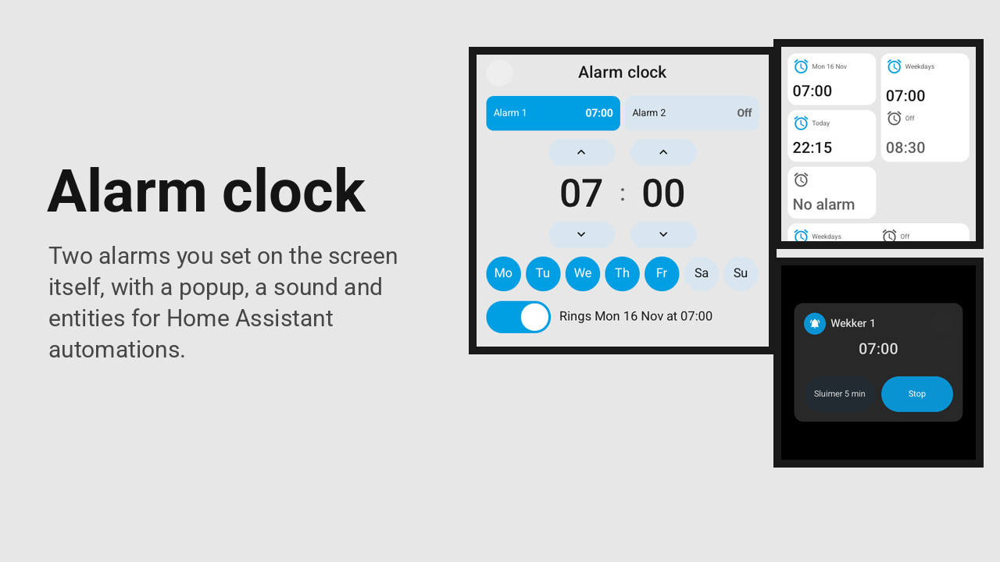
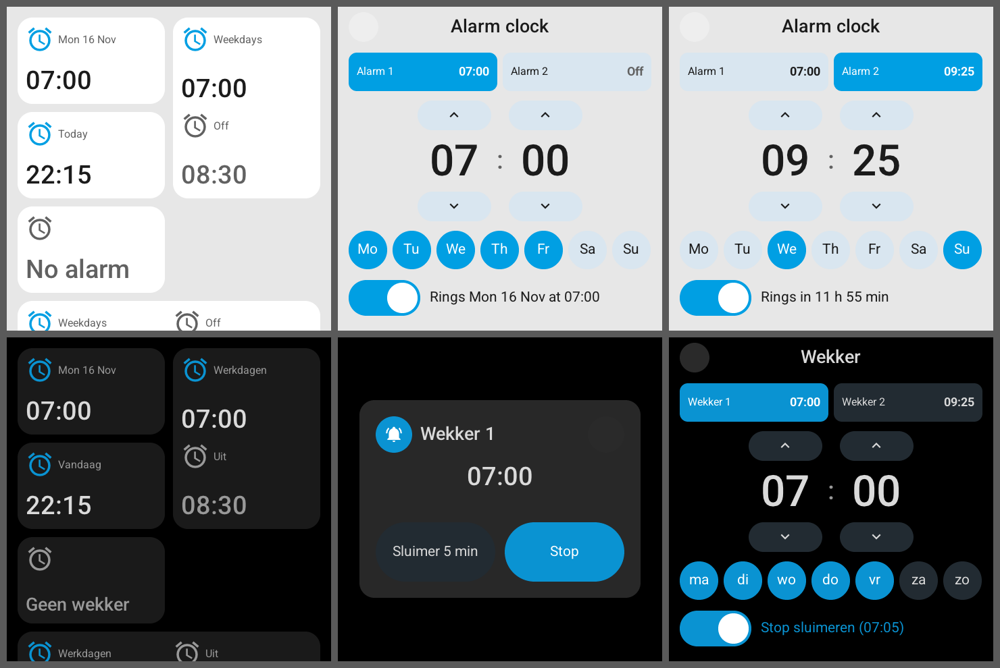

# Wekker

> Nieuw en nog niet op een echt scherm geprobeerd. Het scherm gaat aan en de wekker gaat af, ook 's nachts.

Twee wekkers op een Tessera-scherm, die je op het scherm zelf instelt: geen telefoon en geen Home Assistant nodig om
een wektijd te veranderen. Elke wekker heeft een tijd, de dagen waarop hij afgaat en een aan/uit-schakelaar. Gaat er
een af, dan gaat het scherm aan met een popup met **Sluimeren** en **Stop**, en een scherm met een speaker laat geluid
horen.

Elke wekker is ook een entiteit van het scherm in Home Assistant: een automatisering kan een wekker instellen en iets
doen als hij afgaat, met elke speaker en elk geluid dat je wilt.



## Instellen

1. Open in Tessera Plugins, kies **Add with a link** en plak
   `https://github.com/woldhek/tessera-plugin-alarm-clock`.
2. Vink het scherm aan en pas toe. Het scherm bouwt één keer.
3. Zet in Layout de tegel **Wekker** uit de groep Plugins op een pagina, in elke maat van 1x1 tot 2x2.
4. Tik op het scherm op de tegel. Kies **Wekker 1** of **Wekker 2**, stel de tijd in met de pijltjes, tik de dagen
   aan en zet de schakelaar aan.

## Op het scherm

- **De tegel.** Op 1x1: de volgende wekker, met zijn dag ("Vandaag", "Morgen", een datum). Groter: beide wekkers, elk
  met zijn tijd en zijn dagen ("Werkdagen", "ma–do", "Weekend", "Eenmalig"), naast elkaar op een brede tegel en onder
  elkaar op een hoge. Een wekker die uit staat is grijs. Een tik opent de kaart.
- **De kaart.** Bovenaan de twee wekkers, elk met zijn tijd. Daaronder de tijd van de gekozen wekker in grote cijfers,
  met een pijltje omhoog boven en omlaag onder de uren en de minuten (de minuten gaan per vijf). Dan zijn dagen als
  ronde toetsen, maandag eerst, en onderaan een schakelaar met wanneer hij afgaat: "Gaat af over 9 u 30 min", of een
  dag en een tijd als dat meer dan een dag weg is. Elke tik wordt meteen bewaard: er is niets om op te slaan.
- **Geen dagen gekozen**: de wekker gaat één keer af, op zijn eerstvolgende tijd, en zet zichzelf uit.
- **Als een wekker afgaat** gaat het scherm aan, ook vanuit stand-by en 's nachts, met de popup met de naam van de
  wekker en de tijd. **Stop** beëindigt hem. **Sluimer 5 min** laat hem later opnieuw afgaan; de sluittoets van de
  popup en een tik naast de popup sluimeren ook. Terwijl hij sluimert zegt de tegel dat, en stopt de rij van de
  schakelaar op de kaart hem.
- **Niemand in de buurt**: een wekker stopt vanzelf na tien minuten (een instelling), en een wekker die steeds weer
  sluimert geeft het op een uur nadat hij voor het eerst afging.



## Instellingen

Op het scherm: houd de bovenbalk vast, Settings, Plugins, Wekker. In Tessera: het tabblad Plugins van het scherm, de
details van de plugin, **Settings**. Dezelfde waarden zijn entiteiten van het scherm in Home Assistant.

- **Sluimeren**: toon de sluimertoets als een wekker afgaat (standaard aan). Uit: de popup heeft alleen Stop en komt
  terug tot iemand op Stop tikt.
- **Sluimertijd**: 1 tot 30 minuten, standaard 5.
- **Stopt vanzelf na**: 1 tot 60 minuten, standaard 10.
- **Wekkergeluid**: afgaan op de eigen speaker van het scherm (hieronder).
- **Wekker testen**: laat het scherm nu afgaan.

## Geluid

Op een scherm met een speaker, van het bord zelf (de Guition P4-panelen bijvoorbeeld) of van een andere plugin, staat
het onderdeel **Afgaan op de speaker van het scherm** standaard aan: vier korte piepjes per seconde, op het volume van
het scherm, tot de wekker stopt. Op de Guition 4-inch maakt de plugin
[Guition-speaker](https://github.com/woldhek/tessera-plugin-guition-speaker) van zijn speakeruitgang de speaker van
het scherm. Een scherm zonder speaker toont de popup zonder geluid.

Elk ander geluid, op elke speaker, regel je in Home Assistant: zie de automatisering hieronder.

## In Home Assistant

Het apparaat van het scherm krijgt deze entiteiten (`<scherm>` is de naam van het scherm):

| Entiteit | Wat |
|---|---|
| `time.<scherm>_alarm_1_time`, `time.<scherm>_alarm_2_time` | De tijd van de wekker. Stel hem in met de actie `time.set_value`. |
| `switch.<scherm>_alarm_1`, `switch.<scherm>_alarm_2` | De wekker aan of uit. |
| `text.<scherm>_alarm_1_days`, `text.<scherm>_alarm_2_days` | De dagen: een of meer van `mon,tue,wed,thu,fri,sat,sun` met komma's ertussen, of `daily`, `weekdays`, `weekend`. Leeg: hij gaat één keer af. |
| `binary_sensor.<scherm>_alarm_ringing` | Aan terwijl een wekker afgaat (ook een test), uit terwijl hij sluimert en als hij stopt. |
| `binary_sensor.<scherm>_alarm_1_ringing`, `binary_sensor.<scherm>_alarm_2_ringing` | Hetzelfde voor elke wekker apart. |
| `sensor.<scherm>_next_alarm` | Wanneer de volgende wekker afgaat, als tijdstip. |
| `button.<scherm>_stop_alarm`, `button.<scherm>_snooze_alarm` | Stop of sluimer de wekker die afgaat. |
| `button.<scherm>_ring_alarm` | Laat het scherm nu afgaan. |

Een geluid op een speaker in de kamer terwijl de wekker afgaat, en een notificatie. De sensor gaat uit bij Stop en
Sluimeren, en weer aan als het sluimeren voorbij is, dus de speaker volgt:

```yaml
alias: Wekker slaapkamer
mode: restart
triggers:
  - trigger: state
    entity_id: binary_sensor.slaapkamer_alarm_ringing
    to: "on"
    id: afgaan
  - trigger: state
    entity_id: binary_sensor.slaapkamer_alarm_ringing
    to: "off"
    id: stoppen
actions:
  - choose:
      - conditions:
          - condition: trigger
            id: afgaan
        sequence:
          - action: media_player.play_media
            target: { entity_id: media_player.slaapkamer }
            data:
              media_content_id: media-source://media_source/local/wekker.mp3
              media_content_type: music
          - action: notify.mobile_app_mijn_telefoon
            data: { message: "De wekker in de slaapkamer gaat af." }
    default:
      - action: media_player.media_stop
        target: { entity_id: media_player.slaapkamer }
```

Een andere integratie zet de wektijd:

```yaml
actions:
  - action: time.set_value
    target: { entity_id: time.slaapkamer_alarm_1_time }
    data: { time: "06:45:00" }
  - action: switch.turn_on
    target: { entity_id: switch.slaapkamer_alarm_1 }
```

## Goed om te weten

- De wekkers staan op het scherm en gaan af zonder Home Assistant, zolang het scherm zijn klok heeft. Home Assistant
  zet die klok na een start: een scherm dat start terwijl Home Assistant weg is, laat niets afgaan tot het terug is.
- Een wekker gaat af in de minuut van zijn tijd. Een scherm dat precies in die minuut herstart, mist hem.
- Elk scherm heeft zijn eigen twee wekkers.
- Een plugin kan de kaart niet op slot zetten: iedereen bij het scherm kan een wekker veranderen.
- Gecontroleerd met `check.py` van de plugins-repository en een compile tegen de headers van Tessera's release en dev,
  en getekend op een kleine testopstelling, niet op Tessera's preview-bench. Nog niet op een echt scherm gedraaid.
